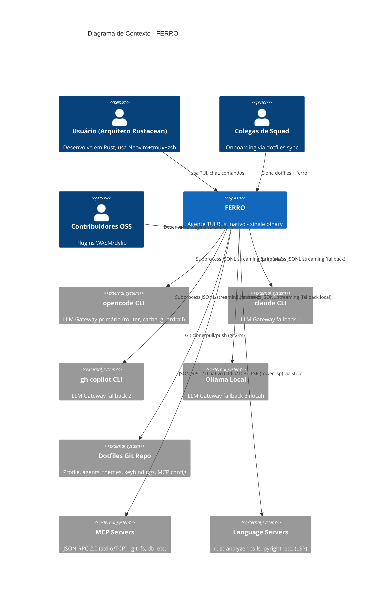
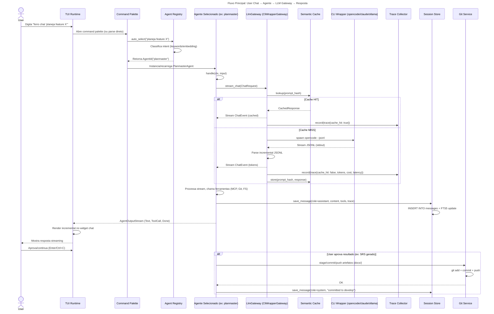
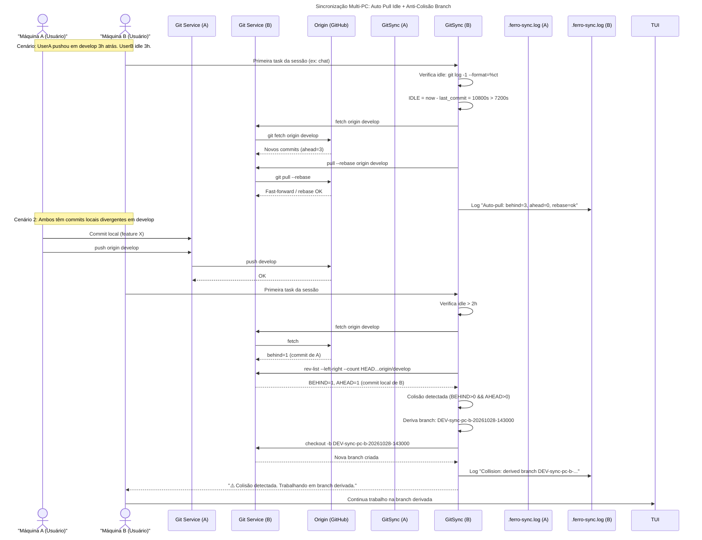
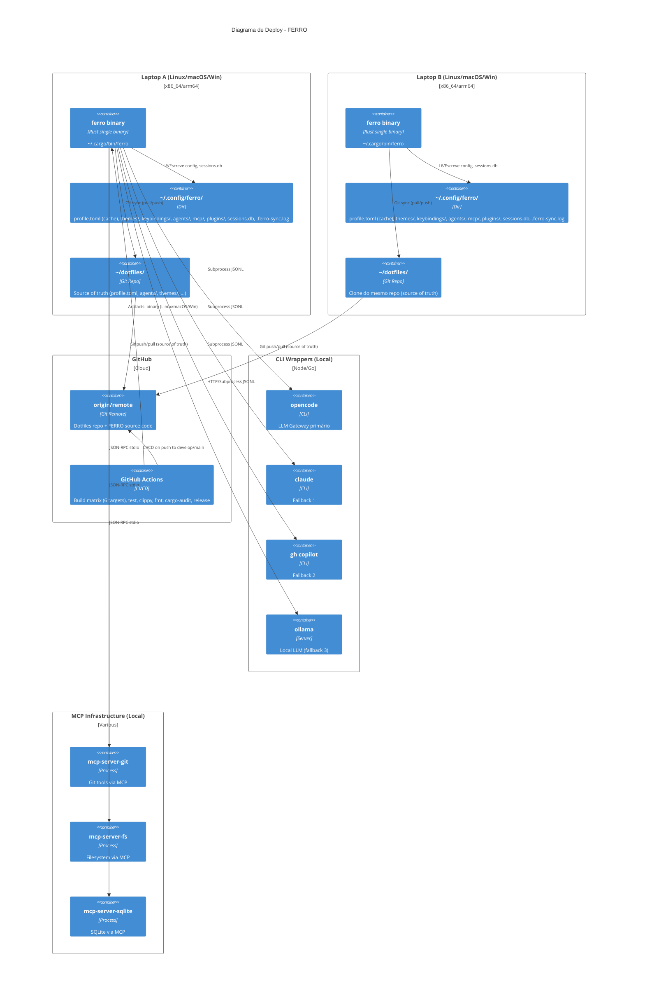

# Arquitetura e UML — Agente TUI Rust (FERRO)

**Versão:** 1.0  
**Data:** 28/10/2026  
**Autor:** PLANMASTER  
**Branch:** develop  
**Base:** `docs/SRS.md` (RFs, RNFs, RNs)

---

## 1. Visão Arquitetural (C4 Level 1 - Context)



---

## 2. Diagrama de Casos de Uso (UML Use Case)

```mermaid
useCaseDiagram
title Casos de Uso - FERRO

actor "Usuário Primário" as user
actor "Sistema (Agentes)" as system
actor "CLI Wrappers LLM" as llm
actor "Dotfiles Git" as git
actor "MCP Servers" as mcp
actor "Language Servers" as lsp

package "Core TUI" {
  usecase "UC-01: Inicializar TUI\n(Cold start < 2s)" as uc1
  usecase "UC-02: Layout Splits/Tabs\n(Vim keys, mouse)" as uc2
  usecase "UC-03: Command Palette\n(Fuzzy search)" as uc3
  usecase "UC-04: Theme/Keybinding\nHot Reload" as uc4
}

package "Agentes Nativos (19)" {
  usecase "UC-05: Registry + Trait Agent" as uc5
  usecase "UC-06: Seleção Auto/Manual Agente" as uc6
  usecase "UC-07: Executar Agente\n(planmaster, backdev, ...)" as uc7
}

package "Perfil/Dotfiles Sync" {
  usecase "UC-08: Git Clone/Pull/Push\n(ferro --sync-profile)" as uc8
  usecase "UC-09: Auto Pull Idle > 2h" as uc9
  usecase "UC-10: Anti-Colisão Branch\n(Derivação automática)" as uc10
}

package "LLM Gateway" {
  usecase "UC-11: Subprocess Manager\n(opencode→claude→gh→ollama)" as uc11
  usecase "UC-12: Streaming JSONL\nRender tempo real" as uc12
  usecase "UC-13: Cache Semântico\n(SQLite + embeddings)" as uc13
  usecase "UC-14: Trace.json\n(Custo, latência, tokens)" as uc14
}

package "Widgets Ricos" {
  usecase "UC-15: Syntax Highlight\n(tree-sitter + syntect)" as uc15
  usecase "UC-16: Diff Inline\n(Myers + staging linha)" as uc16
  usecase "UC-17: LSP Diagnostics\n(Inline + painel + code actions)" as uc17
  usecase "UC-18: File Explorer\n(Git status + CRUD)" as uc18
  usecase "UC-19: Git UI\n(Status, log, stage, commit, push)" as uc19
}

package "Persistência & Integração" {
  usecase "UC-20: SQLite Sessions\n(Histórico, FTS5, export JSONL)" as uc20
  usecase "UC-21: MCP Client\n(JSON-RPC 2.0 nativo)" as uc21
  usecase "UC-22: Plugin System\n(dylib nativo + WASM sandbox)" as uc22
  usecase "UC-23: Secret Redaction\n(Logs, traces, prompts, diffs)" as uc23
  usecase "UC-24: CLI Interface\n(Subcomandos + completions)" as uc24
}

user --> uc1
user --> uc2
user --> uc3
user --> uc4
user --> uc5
user --> uc6
user --> uc7
user --> uc8
user --> uc15
user --> uc16
user --> uc17
user --> uc18
user --> uc19
user --> uc24

system --> uc5
system --> uc7
system --> uc11
system --> uc12
system --> uc13
system --> uc14
system --> uc20
system --> uc21
system --> uc22
system --> uc23

llm --> uc11
llm --> uc12
llm --> uc14

git --> uc8
git --> uc9
git --> uc10

mcp --> uc21

lsp --> uc17
```

---

## 3. Diagrama de Classes / Entidades (UML Class Diagram)

```mermaid
classDiagram
title Modelo de Domínio - FERRO

namespace Core {
  class FerroApp {
    +config: Config
    +agent_registry: AgentRegistry
    +llm_gateway: LlmGateway
    +mcp_client: McpClient
    +session_store: SessionStore
    +git_sync: GitSync
    +plugin_manager: PluginManager
    +tui: TuiRuntime
    +run() Result~()~
    +shutdown() Result~()~
  }

  class Config {
    +profile: ProfileToml
    +theme: Theme
    +keybindings: Keybindings
    +mcp_servers: HashMap~String, McpServerConfig~
    +git_sync: GitSyncConfig
    +reload() Result~()~
    +validate() Result~()~
  }

  class ProfileToml {
    +user: UserProfile
    +agents: Vec~AgentConfig~
    +ui: UiConfig
    +network: NetworkConfig
  }
}

namespace Agent {
  <<trait>> Agent {
    +id() AgentId
    +name() &'static str
    +description() &'static str
    +capabilities() AgentCapabilities
    +handle(ctx: AgentContext, input: AgentInput) Result~AgentOutputStream~
    +configure(config: AgentConfig) Result~()~
  }

  class AgentRegistry {
    +agents: HashMap~AgentId, Box~dyn Agent~~
    +register(agent: Box~dyn Agent~)
    +get(id: &AgentId) Option~&dyn Agent~
    +list() Vec~AgentInfo~
    +auto_select(intent: &str) Result~AgentId~
  }

  class AgentContext {
    +session_id: SessionId
    +workspace: PathBuf
    +config: &Config
    +llm_gateway: &dyn LlmGateway
    +mcp_client: &McpClient
    +git: &GitService
    +fs: &FsService
  }

  class AgentInput {
    +text: String
    +attachments: Vec~Attachment~
    +metadata: HashMap~String, Value~
  }

  class AgentOutputStream {
    <<stream>>
    +Text(String)
    +ToolCall(ToolCall)
    +ToolResult(ToolResult)
    +Done(Result~()~)
    +Error(AgentError)
  }

  class PlanmasterAgent {
    +handle() -> gera SRS/UML/Backlog
  }
  class BackdevAgent {
    +handle() -> implementa código, testes, commit
  }
  class FrontdevAgent {
    +handle() -> telas, componentes, styles
  }
  class EngaiAgent {
    +handle() -> RAG, MCP, agentes, gateway
  }
  class KalimasterAgent {
    +handle() -> SAST/DAST, laudo
  }
  class OpsmasterAgent {
    +handle() -> Docker, CI, cloud, runbook
  }
  class QamasterAgent {
    +handle() -> plano testes, automação, cobertura
  }
  -- 13 outros agentes --
}

namespace Gateway {
  <<trait>> LlmGateway {
    +stream_chat(req: ChatRequest) Result~BoxStream~ChatEvent~~
    +get_models() Result~Vec~ModelInfo~~
    +provider_name() &'static str
  }

  class CliWrapperGateway {
    +primary: CliProvider
    +fallbacks: Vec~CliProvider~
    +cache: SemanticCache
    +tracer: TraceCollector
    +stream_chat() -> fallback chain + JSONL parse
  }

  class CliProvider {
    +name: String
    +command: String
    +args: Vec~String~
    +env: HashMap~String, String~
    +health_check() Result~()~
  }

  class SemanticCache {
    +db: SqlitePool
    +embedder: Embedder
    +threshold: f32
    +get(key: &str) Option~CachedResponse~
    +set(key: &str, value: CachedResponse)
  }

  class TraceCollector {
    +db: SqlitePool
    +record(trace: TraceEvent)
    +export_jsonl(path: &Path) Result~()~
  }
}

namespace Git {
  class GitService {
    +repo: Repository
    +status() Result~GitStatus~
    +log(limit: usize) Result~Vec~Commit~~
    +diff(opts: DiffOptions) Result~Diff~
    +stage(paths: &[PathBuf]) Result~()~
    +unstage(paths: &[PathBuf]) Result~()~
    +commit(msg: &str) Result~Oid~
    +push(remote: &str, branch: &str) Result~()~
    +pull(remote: &str, branch: &str) Result~()~
    +branch_list() Result~Vec~Branch~~
    +checkout(branch: &str) Result~()~
    +create_branch(name: &str) Result~()~
    +stash_push(msg: &str) Result~()~
    +stash_pop() Result~()~
  }

  class GitSync {
    +service: GitService
    +config: GitSyncConfig
    +auto_pull_if_idle() Result~()~
    +check_collision() Result~CollisionResult~
    +derive_branch() Result~String~
    +sync_profile(direction: SyncDirection) Result~()~
  }
}

namespace MCP {
  class McpClient {
    +servers: HashMap~String, McpConnection~
    +connect(config: McpServerConfig) Result~()~
    +call_tool(server: &str, tool: &str, args: Value) Result~Value~
    +list_tools(server: &str) Result~Vec~Tool~~
    +list_resources(server: &str) Result~Vec~Resource~~
  }

  class McpConnection {
    +transport: Transport
    +request_id: AtomicU64
    +send_request(method: &str, params: Value) Result~Value~
    +handle_notification(method: &str, params: Value)
  }
}

namespace LSP {
  class LspClient {
    +servers: HashMap~String, LspServer~
    +start_server(config: LspServerConfig) Result~()~
    +did_open(uri: &str, text: &str) Result~()~
    +did_change(uri: &str, changes: Vec~TextEdit~~) Result~()~
    +diagnostics(uri: &str) Result~Vec~Diagnostic~~
    +code_actions(uri: &str, range: Range) Result~Vec~CodeAction~~
    +goto_definition(uri: &str, pos: Position) Result~Vec~Location~~
    +completion(uri: &str, pos: Position) Result~Vec~CompletionItem~~
  }
}

namespace Session {
  class SessionStore {
    +pool: SqlitePool
    +create_session(agent: AgentId) Result~Session~
    +get_session(id: SessionId) Result~Option~Session~~
    +save_message(session: SessionId, msg: Message) Result~()~
    +search_fts(query: &str) Result~Vec~Message~~
    +export_jsonl(path: &Path) Result~()~
    +import_jsonl(path: &Path) Result~()~
  }

  class Session {
    +id: SessionId
    +created_at: DateTime~Utc~
    +agent_id: AgentId
    +workspace: PathBuf
    +messages: Vec~Message~
  }

  class Message {
    +id: MessageId
    +session_id: SessionId
    +role: Role
    +content: String
    +tool_calls: Vec~ToolCall~
    +tokens: TokenUsage
    +cost_usd: f64
    +latency_ms: u64
    +cache_hit: bool
  }
}

namespace Plugin {
  <<trait>> Plugin {
    +metadata() PluginMetadata
    +init(config: &Config) Result~()~
    +shutdown() Result~()~
  }

  class PluginManager {
    +dylib_loader: LibLoadingLoader
    +wasm_runtime: WasmtimeRuntime
    +load_dylib(path: &Path) Result~Box~dyn Agent~~
    +load_wasm(path: &Path, caps: Capabilities) Result~Box~dyn Agent~~
    +hot_reload(plugin_id: &str) Result~()~
  }

  class WasmtimeRuntime {
    +engine: Engine
    +store: Store~WasiCtx~
    +instantiate(module: &[u8], caps: Capabilities) Result~Instance~
    +fuel_limit: u64
    +memory_limit: usize
  }
}

namespace TUI {
  class TuiRuntime {
    +terminal: Terminal~CrosstermBackend~
    +layout: LayoutManager
    +widgets: WidgetRegistry
    +event_loop() Result~()~
    +render() Result~()~
    +handle_event(event: Event) Result~()~
  }

  class LayoutManager {
    +splits: Vec~Split~
    +tabs: Vec~Tab~
    +focused: WidgetId
    +resize_split(id: SplitId, ratio: f32)
    +switch_tab(index: usize)
  }

  class WidgetRegistry {
    +widgets: HashMap~WidgetId, Box~dyn Widget~~
    +register(widget: Box~dyn Widget~)
    +get(id: &WidgetId) Option~&dyn Widget~
  }
}

FerroApp --> Config
FerroApp --> AgentRegistry
FerroApp --> LlmGateway
FerroApp --> McpClient
FerroApp --> SessionStore
FerroApp --> GitSync
FerroApp --> PluginManager
FerroApp --> TuiRuntime

AgentRegistry --> Agent : manages
AgentRegistry --> PlanmasterAgent
AgentRegistry --> BackdevAgent
AgentRegistry --> FrontdevAgent
AgentRegistry --> EngaiAgent
AgentRegistry --> KalimasterAgent
AgentRegistry --> OpsmasterAgent
AgentRegistry --> QamasterAgent

Agent <|-- PlanmasterAgent
Agent <|-- BackdevAgent
Agent <|-- FrontdevAgent
Agent <|-- EngaiAgent
Agent <|-- KalimasterAgent
Agent <|-- OpsmasterAgent
Agent <|-- QamasterAgent

CliWrapperGateway ..|> LlmGateway
CliWrapperGateway --> CliProvider
CliWrapperGateway --> SemanticCache
CliWrapperGateway --> TraceCollector

GitSync --> GitService
GitService --> Repository : git2

McpClient --> McpConnection
McpConnection --> Transport : stdio/TCP

LspClient --> LspServer : tower-lsp

SessionStore --> SqlitePool : sqlx
SessionStore --> Session
SessionStore --> Message

PluginManager --> Plugin : loads
PluginManager --> WasmtimeRuntime
PluginManager --> LibLoadingLoader

TuiRuntime --> LayoutManager
TuiRuntime --> WidgetRegistry
```

---

## 4. Diagrama de Sequência - Fluxo Principal: Chat com Agente



---

## 5. Diagrama de Sequência - Sincronização Multi-PC (Auto Pull + Anti-Colisão)



---

## 6. Diagrama de Componentes (C4 Level 2 - Container)

```mermaid
C4Container
title Diagrama de Containers - FERRO (Cargo Workspace)

Container_Boundary(workspace, "ferro Workspace (Cargo)") {
  Container(core, "ferro-core", "Rust", "Config, traits, errors, utils, logging (tracing)")
  Container(tui, "ferro-tui", "Rust + ratatui", "TUI Runtime, Layout, Widgets, Event Loop, Themes")
  Container(agents, "ferro-agents", "Rust", "19 Agent crates + AgentRegistry + Agent Trait")
  Container(gateway, "ferro-gateway", "Rust", "LlmGateway trait, CliWrapperGateway, SemanticCache, TraceCollector")
  Container(plugins, "ferro-plugins", "Rust + wasmtime", "PluginManager, dylib loader (libloading), WASM runtime")
  Container(mcp, "ferro-mcp", "Rust", "McpClient, JSON-RPC 2.0, Transport (stdio/TCP)")
  Container(git, "ferro-git", "Rust + git2", "GitService, GitSync, DiffView, BranchManager")
  Container(lsp, "ferro-lsp", "Rust + tower-lsp", "LspClient, Diagnostics, CodeActions, Completion")
  Container(session, "ferro-session", "Rust + sqlx", "SessionStore, Message, FTS5, Export/Import")
  Container(cli, "ferro-cli", "Rust + clap", "CLI entrypoint, subcommands, completions")
}

Container_Ext(opencode, "opencode CLI", "Node/Go", "LLM Router, Cache, Guardrail, Trace")
Container_Ext(claude, "claude CLI", "Node", "Anthropic SDK wrapper")
Container_Ext(gh_copilot, "gh copilot CLI", "Go", "GitHub Copilot API wrapper")
Container_Ext(ollama, "Ollama", "Go", "Local LLM server (HTTP API)")
Container_Ext(dotfiles, "Dotfiles Git Repo", "Git", "profile.toml, agents/, themes/, keybindings/, mcp/")
Container_Ext(mcp_servers, "MCP Servers", "Various", "git, filesystem, database, etc. (JSON-RPC 2.0)")
Container_Ext(language_servers, "Language Servers", "Various", "rust-analyzer, ts-ls, pyright, etc. (LSP 3.17)")

Rel(cli, tui, "Inicia TUI")
Rel(cli, agents, "Non-interactive: --agent <id> 'prompt'")
Rel(cli, gateway, "Non-interactive: chat direto")
Rel(cli, git, "--sync-profile pull|push|status")
Rel(tui, core, "Config, logging, traits")
Rel(tui, agents, "Registry, seleção, execução")
Rel(tui, gateway, "Stream chat via agents")
Rel(tui, mcp, "Tool calling via agents")
Rel(tui, git, "Git UI widgets")
Rel(tui, lsp, "LSP widget (diagnostics, goto)")
Rel(tui, session, "Histórico, busca, export")
Rel(tui, plugins, "Carrega plugins custom")
Rel(agents, gateway, "Consome LlmGateway")
Rel(agents, mcp, "Chama mcp.call_tool()")
Rel(agents, git, "Git ops (commit, diff, log)")
Rel(agents, session, "Persiste mensagens, traces")
Rel(gateway, opencode, "Subprocess JSONL (primário)")
Rel(gateway, claude, "Subprocess JSONL (fallback 1)")
Rel(gateway, gh_copilot, "Subprocess JSONL (fallback 2)")
Rel(gateway, ollama, "Subprocess JSONL (fallback 3)")
Rel(gateway, session, "Salva trace.json")
Rel(git, dotfiles, "Git clone/pull/push (git2)")
Rel(mcp, mcp_servers, "JSON-RPC 2.0 (stdio/TCP)")
Rel(lsp, language_servers, "LSP via stdio (tower-lsp)")
Rel(plugins, agents, "Implementa Agent trait (dylib/WASM)")
```



---

## 7. Diagrama de Deploy (C4 Level 3 - Deployment)



---

## 8. Estrutura do Cargo Workspace

```mermaid
graph TD
    subgraph Workspace [ferro/]
        root[Cargo.toml (workspace)]
        
        subgraph Core Crates
            core[ferro-core]
            tui[ferro-tui]
            agents[ferro-agents]
            gateway[ferro-gateway]
            plugins[ferro-plugins]
            mcp[ferro-mcp]
            git[ferro-git]
            lsp[ferro-lsp]
            session[ferro-session]
            cli[ferro-cli]
        end
    end

    root --> core
    root --> tui
    root --> agents
    root --> gateway
    root --> plugins
    root --> mcp
    root --> git
    root --> lsp
    root --> session
    root --> cli

    core --> tui
    core --> agents
    core --> gateway
    core --> plugins
    core --> mcp
    core --> git
    core --> lsp
    core --> session
    core --> cli

    tui --> agents
    tui --> gateway
    tui --> git
    tui --> lsp
    tui --> session
    tui --> plugins

    agents --> gateway
    agents --> mcp
    agents --> git
    agents --> session
    agents --> plugins

    gateway --> session

    plugins --> agents
```

### Detalhamento das Crates

| Crate | Responsabilidade | Dependências Principais |
|-------|------------------|------------------------|
| `ferro-core` | Config (figment), Traits (Agent, LlmGateway, Plugin), Errors, Logging (tracing), Utils | figment, serde, toml, tracing, thiserror, anyhow |
| `ferro-tui` | Terminal UI: ratatui, crossterm, tachyonfx, opaline, ratatui-code-editor, skim, layout, widgets | ratatui, crossterm, tachyonfx, opaline, syntect, skim, ferro-core |
| `ferro-agents` | AgentRegistry, 19 agent crates (planmaster, backdev, ...), trait Agent | ferro-core, ferro-gateway, ferro-mcp, ferro-git, ferro-session |
| `ferro-gateway` | LlmGateway trait, CliWrapperGateway, SemanticCache (candle), TraceCollector | ferro-core, ferro-session, candle, sqlx, tokio |
| `ferro-plugins` | PluginManager, libloading (dylib), wasmtime (WASM), capability system | ferro-core, libloading, wasmtime, wasi |
| `ferro-mcp` | McpClient, JSON-RPC 2.0, Transport (stdio/TCP), Tool/Resource calling | ferro-core, serde_json, tokio, tokio-util |
| `ferro-git` | GitService (git2), GitSync (auto-pull, anti-collision), DiffView (diffrs) | ferro-core, git2, diffrs, similar |
| `ferro-lsp` | LspClient (tower-lsp), Diagnostics widget, Code Actions, Go-to-def | ferro-core, tower-lsp, lsp-types, tokio |
| `ferro-session` | SessionStore (sqlx + SQLite), FTS5, Export/Import JSONL | ferro-core, sqlx, sqlite, tantivy (opcional) |
| `ferro-cli` | CLI entrypoint (clap), subcomandos, completions, non-interactive mode | ferro-core, ferro-tui, ferro-agents, ferro-gateway, ferro-git, clap |

---

## 9. Fluxo de Dados Principal (Data Flow Diagram)

```mermaid
flowchart TD
    subgraph Input
        UI[User Input\nChat / Command / Key]
        CLI[CLI Args\nferro chat '...']
        MCP_IN[MCP Notification]
        LSP_IN[LSP Notification]
    end

    subgraph Core_Processing
        TUI[TUI Event Loop]
        CMD[Command Palette\nFuzzy Match]
        REG[Agent Registry\nAuto/Manual Select]
        AGENT[Agent.handle()\nAgent Trait]
        GW[LlmGateway\nstream_chat]
        CACHE[Semantic Cache\nSQLite + Embeddings]
        MCP_CLI[McpClient\ncall_tool]
        GIT[GitService\nstatus/diff/commit]
        LSP_CLI[LspClient\ndiagnostics/goto]
        SESS[SessionStore\npersist messages]
    end

    subgraph External
        OPENCODE[opencode CLI]
        CLAUDE[claude CLI]
        GH[gh copilot CLI]
        OLLAMA[ollama Local]
        MCP_SRV[MCP Servers]
        LSP_SRV[Language Servers]
        DOTFILES[Dotfiles Git Repo]
    end

    subgraph Output
        RENDER[TUI Render\nWidgets Update]
        STDOUT[Stdout\nNon-interactive]
        TRACE[Trace.json\nSQLite + File]
        GIT_OUT[Git Push\nCommits/Artifacts]
    end

    UI --> TUI
    CLI --> TUI
    MCP_IN --> MCP_CLI
    LSP_IN --> LSP_CLI

    TUI --> CMD
    TUI --> REG
    CMD --> REG
    REG --> AGENT
    AGENT --> GW
    AGENT --> MCP_CLI
    AGENT --> GIT
    AGENT --> LSP_CLI
    AGENT --> SESS

    GW --> CACHE
    CACHE -.->|HIT| GW
    GW --> OPENCODE
    GW --> CLAUDE
    GW --> GH
    GW --> OLLAMA
    GW --> TRACE

    MCP_CLI --> MCP_SRV
    LSP_CLI --> LSP_SRV
    GIT --> DOTFILES

    AGENT --> RENDER
    AGENT --> STDOUT
    AGENT --> TRACE
    GIT --> GIT_OUT
    SESS --> TRACE
```

---

## 10. Decisões Arquiteturais (ADRs) - Resumo

| ADR | Título | Status | Arquivo |
|-----|--------|--------|---------|
| ADR-001 | Plugin Architecture: dylib nativo (MVP) → WASM (v1.1+) | Accepted | `docs/04-ADRs/ADR-001-plugin-architecture.md` |
| ADR-002 | LLM Gateway: CLI Wrapper Subprocess + JSONL Streaming | Accepted | `docs/04-ADRs/ADR-002-llm-gateway.md` |
| ADR-003 | Sandbox Strategy: wasmtime Capability-based (WASI) | Accepted | `docs/04-ADRs/ADR-003-sandbox-strategy.md` |
| ADR-004 | Multi-PC Sync: Auto Pull Idle + Anti-Colisão Branch Derivação | Accepted | `docs/04-ADRs/ADR-004-multi-pc-sync.md` |
| ADR-005 | Config Management: Dotfiles Git + Figment Layering + Hot Reload | Accepted | `docs/04-ADRs/ADR-005-config-management.md` |
| ADR-006 | TUI Framework: ratatui + Ecosystem (tachyonfx, opaline, syntect) | Accepted | `docs/04-ADRs/ADR-006-tui-framework.md` |
| ADR-007 | Agent Model: Native Rust Trait + Dynamic Registry + Cargo Features | Accepted | `docs/04-ADRs/ADR-007-agent-model.md` |
| ADR-008 | Persistence: SQLite (sqlx) + FTS5 + JSONL Export | Accepted | `docs/04-ADRs/ADR-008-persistence.md` |

---

## 11. Convenções de Código e Padrões

### 11.1 Naming Conventions
| Elemento | Convenção | Exemplo |
|----------|-----------|---------|
| Crates | `ferro-*` kebab-case | `ferro-tui`, `ferro-agents` |
| Módulos | snake_case | `agent_registry`, `llm_gateway` |
| Structs/Enums | PascalCase | `AgentContext`, `ChatRequest` |
| Traits | PascalCase + sufixo opcional | `Agent`, `LlmGateway` |
| Funções/Variáveis | snake_case | `handle_request`, `session_id` |
| Constantes | SCREAMING_SNAKE | `DEFAULT_IDLE_HOURS` |
| Features Cargo | kebab-case | `planmaster`, `backdev`, `wasm-sandbox` |

### 11.2 Error Handling
- **Tipos de erro:** `thiserror` para erros de domínio, `anyhow` para erros de aplicação
- **Propagação:** `Result<T, E>` em todas as APIs públicas; `?` operator
- **Logging:** `tracing` spans em operações longas (LLM, Git, LSP); `error!`/`warn!`/`info!`/`debug!`

### 11.3 Async Patterns
- **Runtime:** tokio (full features: rt-multi-thread, macros, sync, fs, net, time)
- **Streams:** `futures::Stream` + `tokio-stream` para LLM streaming, MCP notifications
- **Cancellation:** `CancellationToken` (tokio-util) para operações longas
- **Timeouts:** `tokio::time::timeout` em todas chamadas externas (CLI, MCP, LSP, Git)

### 11.4 Testing Strategy
| Nível | Tool | Cobertura Alvo |
|-------|------|----------------|
| Unit | `cargo test` + `mockall` | > 80% (linhas) |
| Integration | `cargo test --test integration` | 100% critical paths (sync, gateway, agent registry) |
| E2E | `ferro` binary + `assert_cmd` | Happy paths: chat, sync, audit, plugin load |
| Property | `proptest` | Serialização, parsing, diff algorithm |
| Fuzz | `cargo fuzz` | JSONL parsing, MCP messages, config TOML |

---

> **Próximo passo:** FASE 5 — Backlog Scrum (`docs/05-backlog.md`) com Épicos, User Stories, Sprints (6×2 semanas), DoR/DoD, Roadmap.